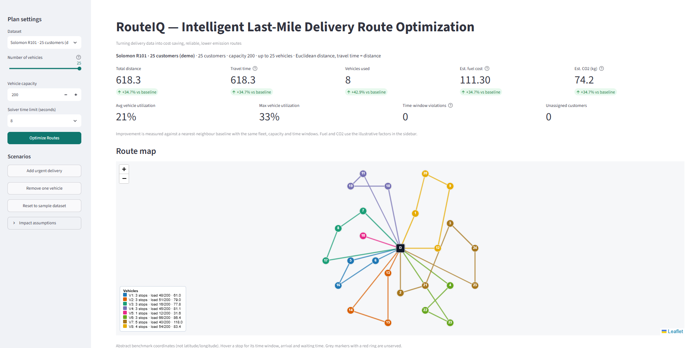
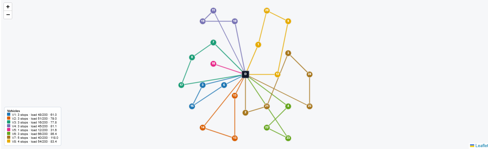
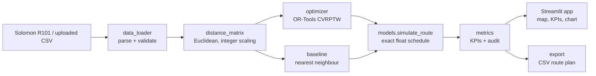

# RouteIQ — Intelligent Last-Mile Delivery Route Optimization

> **Turning delivery data into cost-saving, reliable, lower-emission routes.**

RouteIQ is a free, browser-based decision-support tool that converts delivery-stop
data into optimized multi-vehicle routes. It respects vehicle capacity, delivery
time windows, service times, and depot deadlines, then quantifies the impact
against a fair baseline.

[Live Demo](YOUR_STREAMLIT_DEMO_URL) · [Validation Results](#validation-results) · [License](#license)


## Try the demo

1. Open the live demo link. The Solomon R101 sample dataset, with 25 customers, is preloaded and a default optimization is generated when the app loads.
2. Review the KPI cards, route map, and baseline comparison.
3. Click **Optimize Routes** after changing vehicles, capacity, or solver time.
4. Click **Add urgent delivery** or **Remove one vehicle** to test a scenario.
5. Download the optimized route plan as CSV.

## Screenshots

### Route optimization dashboard



### Optimized route map



## Why RouteIQ is different

RouteIQ is a decision-support tool, not only a route visualizer:

- It optimizes under real operational constraints: capacity, time windows, service time, and depot deadline.
- It compares against a fair baseline that obeys exactly the same constraints.
- It lets managers test urgent orders and fleet cuts, and tells them which customers cannot be served.
- It reports transparent operational and environmental KPIs, and an independent audit re-checks every route.
- Dispatchers stay in control: RouteIQ recommends, people decide.

## Problem statement

Small delivery operations often plan routes with spreadsheets or nearest-stop logic. That means more kilometres, more vehicles than needed, missed time windows, and no way to test “what if” changes.

The underlying problem is the **Capacitated Vehicle Routing Problem with Time Windows (CVRPTW)**, which is NP-hard, so it needs an optimization solver rather than manual planning.

## Why I built RouteIQ

Small delivery teams often plan routes manually or with simple nearest-stop logic. That can produce longer routes, unnecessary vehicles, missed time windows, and no practical way to test operational changes.

I built RouteIQ to make route planning a measurable decision process. A dispatcher can compare an optimized plan with a constraint-aware baseline, inspect routes, test urgent orders or fleet reductions, and export a driver-ready plan.

The goal was not only to produce shorter routes, but to make trade-offs between distance, punctuality, fleet size, utilization, cost, and emissions visible and actionable.

## Target users

- Dispatchers and managers of small and mid-sized delivery fleets
- Logistics and supply-chain teams evaluating route plans
- Students learning operations research and decision intelligence

## Features

- Opens on the Solomon R101 benchmark with 25 customers; preloaded sample dataset.
- Includes a selectable 100-customer version for benchmarking.
- Upload your own CSV with validation and clear error messages.
- One-click optimization with capacity, time windows, service times, and depot due time.
- Fair nearest-neighbour baseline under identical constraints.
- KPI dashboard: distance, travel time, vehicles, utilization, violations, unassigned customers, fuel cost, CO2, and percentage improvement.
- Interactive Folium map, route table, baseline chart, and driver-ready CSV download.
- Scenarios: add an urgent delivery, remove a vehicle, change capacity, or reset.

## Architecture



## Design decisions

| Decision | Reason |
|---|---|
| Google OR-Tools | Mature solver for CVRPTW with capacity, time-window, and service-time constraints |
| Streamlit | Fast Python-only interface for an interactive decision-support dashboard |
| Folium | Lightweight interactive mapping without paid map APIs |
| Solomon R101 | Standardized, reproducible benchmark with published reference results |
| Constraint-aware baseline | Makes the optimization comparison meaningful and fair |
| Integer scaling in OR-Tools | OR-Tools works with integers; final schedules are re-simulated in floating point |
| Human-in-the-loop design | RouteIQ recommends plans; dispatchers make final operational decisions |

## Technology stack

Python 3.11+, Google OR-Tools, Streamlit, Folium + streamlit-folium, Pandas/NumPy, Plotly, pytest, Git/GitHub, and Streamlit Community Cloud.

All tools are free and open source; no API keys are required.

## Dataset and attribution

Solomon VRPTW benchmark, instance **R101**.

Original reference:

> M. Solomon, “Algorithms for the Vehicle Routing and Scheduling Problems with Time Window Constraints,” *Operations Research*, 35(2), 1987.

Official source:  
[https://www.sintef.no/projectweb/top/vrptw/solomon-benchmark/](https://www.sintef.no/projectweb/top/vrptw/solomon-benchmark/)

Please review SINTEF’s terms of use before redistributing the benchmark files.

The copy in `data/raw/R101.txt` was fetched from a public GitHub mirror (`iRB-Lab/py-ga-VRPTW`) because `sintef.no` was unreachable from the build environment. It has the expected R101 structure: depot at `(35, 35)`, depot due time 230, capacity 200, and 100 customers. To use the official file, replace it and run:

```bash
python scripts/prepare_data.py
```

The demo uses the depot plus customers 1–25, with no sampling. This matches SINTEF’s definition of the 25-customer instances: the first 25 customers of the 100-customer instances.

Distances are Euclidean distances on abstract x-y coordinates, and travel time equals distance under the Solomon convention.

## Run locally

```bash
python -m venv .venv
source .venv/bin/activate  # macOS/Linux
# Windows: .venv\Scripts\activate

pip install -r requirements-dev.txt
streamlit run app.py
```

Run the test suite:

```bash
pytest
```

Run validation:

```bash
python scripts/validate.py
```

This writes results to `results/validation_results.csv`.

## Deploy on Streamlit Community Cloud

1. Push this repository to GitHub as a public repository.
2. At [share.streamlit.io](https://share.streamlit.io), choose **New app**.
3. Select the repository and branch.
4. Set the main file path to `app.py`.
5. Under **Advanced settings**, select Python 3.11 or newer.
6. Deploy.

All data files are in the repository; nothing is downloaded at runtime.

## How the OR-Tools model works

- One vehicle per route; each route starts and ends at the depot.
- A capacity dimension limits the demand served by each vehicle.
- A time dimension adds travel plus service time at the departure node.
- Waiting is allowed before a customer’s ready time.
- Service must begin within each customer’s `[ready, due]` time window.
- Each route must return to the depot by the depot due time.
- The objective minimizes distance and includes a fixed cost per vehicle used, so fleet size is minimized first, following the Solomon ranking convention.
- Customers are optional with a very large drop penalty, so an undersized fleet yields the best partial plan and a list of unserved customers rather than “no solution.”
- Search uses `PARALLEL_CHEAPEST_INSERTION` followed by `GUIDED_LOCAL_SEARCH`, time-limited to 8 seconds by default.
- OR-Tools is integer-only, so values are scaled by 100 with conservative rounding: travel, service, and ready times are rounded up, while due times are rounded down.
- Any plan feasible in integer arithmetic is feasible in exact arithmetic; reported schedules are re-simulated in floating point.

## Baseline methodology

Nearest neighbour, one vehicle at a time:

1. Start at the depot.
2. Move to the nearest unvisited customer that keeps capacity, the customer’s time window, and the return to the depot by its due time feasible.
3. When no feasible customer remains, close the route and start the next vehicle.
4. Continue up to the same fleet limit.
5. Any customer left unassigned is reported as unassigned.

An improvement percentage is shown only when both plans serve the same customers.

## KPI definitions and assumptions

| KPI | Definition |
|---|---|
| Distance / travel time | Sum of route legs including depot legs; equal under the Solomon convention |
| Utilization | Route load ÷ vehicle capacity, averaged or maximized over used vehicles |
| Time-window violations | Stops whose service starts after the due time. Both planners enforce windows as hard constraints, so 0 is expected; an independent audit re-checks it |
| Fuel cost | Distance × 0.18; configurable and illustrative |
| CO2 | Distance × 0.12 kg; configurable and illustrative |
| Improvement | `(baseline − RouteIQ) ÷ baseline` |

Fuel and CO2 factors are illustrative per abstract distance unit, not measured values.

## Validation results

Reproduce with:

```bash
python scripts/validate.py
```

Validation uses a fleet limit of 25, with an 8-second solver limit for R101-25 and a 30-second solver limit for R101-100. Distances below are double precision.

| Instance | Method | Vehicles | Distance | Unassigned | Result |
|---|---|---:|---:|---:|---|
| R101-25 | RouteIQ | 8 | 618.3 | 0 | 34.7% less distance and 42.9% fewer vehicles than baseline |
| R101-25 | Nearest neighbour | 14 | 947.2 | 0 | Baseline |
| R101-100 | RouteIQ | 19 | 1653.5 | 0 | Serves all 100 customers; 0.17% above published best-known distance |
| R101-100 | Nearest neighbour | 25 | 1666.1 | 21 | Serves only 79 customers, so no improvement percentage is shown |

For R101-100, the baseline cannot serve every customer within the instance’s constraints, so a percentage improvement would not be like-for-like. The meaningful result is that RouteIQ serves all 100 customers with fewer vehicles and stays close to the published best-known solution.

### App versus validation script for R101-100

The app’s solver limit tops out at 10 seconds. Selecting the 100-customer dataset at the 8-second default produces 19 vehicles and a distance of about 1680, roughly 1.9% above best known.

The 30-second run in `scripts/validate.py` reaches 1653.5. Both use 19 vehicles; the additional time only shortens the routes.

### Reference values and distance conventions

SINTEF’s Solomon tables use a hierarchical objective: vehicles first, then distance. For the 100-customer instances, distances are computed in double precision. SINTEF notes that earlier, slightly better R101 values came from lower-precision arithmetic and that exact-method results are not directly comparable.

RouteIQ therefore compares like with like:

- **R101-100:** best known is 19 vehicles / 1650.80 in double precision. RouteIQ achieves 19 / 1653.5, a gap of 0.17%.
- **R101-25:** exact-method papers, which typically truncate distances to one decimal, report 8 vehicles / 617.1. Scored with that convention, RouteIQ’s plan totals 617.10, matching the reference. In double precision, the same plan totals 618.3. No percentage gap is claimed for the double-precision figure.

Results vary slightly between runs and machines because the search is time-limited.

Source:  
[https://www.sintef.no/projectweb/top/vrptw/100-customers](https://www.sintef.no/projectweb/top/vrptw/100-customers)

## Limitations

- Abstract benchmark coordinates; no road network, traffic, or live data.
- R101 is time-window-bound, so capacity utilization is low, about 21% on average. This is a property of the instance, not a bug.
- Nearest neighbour is a deliberately simple baseline; stronger heuristics would narrow the gap.
- Time-limited metaheuristic: near-optimal, not proven optimal.
- Fuel and CO2 are illustrative factors.
- Comparisons with published results depend on the distance-precision convention.

## Responsible AI and data privacy

- **Human in the loop:** RouteIQ recommends; dispatchers decide.
- **Transparent assumptions:** Assumptions are shown in the UI and documented in this README.
- **Open data only:** The public demo uses open benchmark data.
- **No persistent uploads:** Uploaded CSVs are processed in the session and not stored.
- **Operational review required:** Plans optimize cost and distance; they do not model driver fatigue, workload fairness, or local regulations. Review before execution.

## Project context

RouteIQ was originally developed for **DataNova 2026 — Global Data-thon** in the **Operations Research and Decision Intelligence** track.

It is designed as a reusable decision-support tool for last-mile delivery teams, not only as a competition submission.

## Roadmap

- Road-network travel times using OpenStreetMap
- Live traffic-aware routing
- Address geocoding with caching
- GPS and driver tracking
- Dynamic order insertion
- Multi-day scheduling and demand forecasting

## License

The RouteIQ source code is released under the [MIT License](LICENSE).

The Solomon benchmark data is not covered by this license. See the SINTEF page and Solomon (1987) for its terms.

## Citation

- M. Solomon, “Algorithms for the Vehicle Routing and Scheduling Problems with Time Window Constraints,” *Operations Research*, 35(2), 1987.
- SINTEF, “Solomon VRPTW Benchmark,” https://www.sintef.no/projectweb/top/vrptw/solomon-benchmark/

## Author

**Your Name**  
Sole Developer & Product Owner

I designed and built RouteIQ end-to-end:

- Defined the product problem, users, KPIs, and scenario workflow.
- Processed and validated the Solomon R101 VRPTW benchmark dataset.
- Implemented the OR-Tools CVRPTW optimization model.
- Built the constraint-aware nearest-neighbour baseline and KPI audit.
- Developed the Streamlit dashboard, Folium route map, and CSV export.
- Wrote tests, documentation, and deployment configuration.
- Deployed the public demo on Streamlit Community Cloud.

